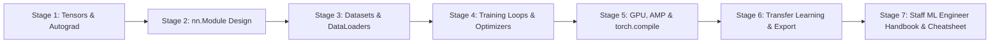
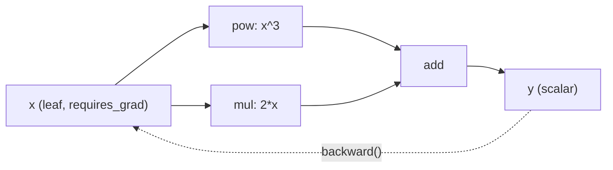
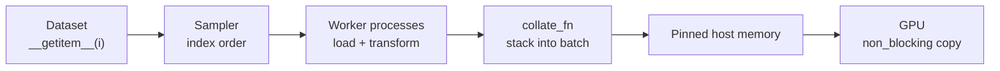
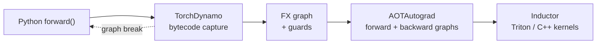
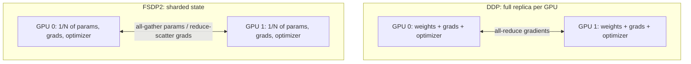
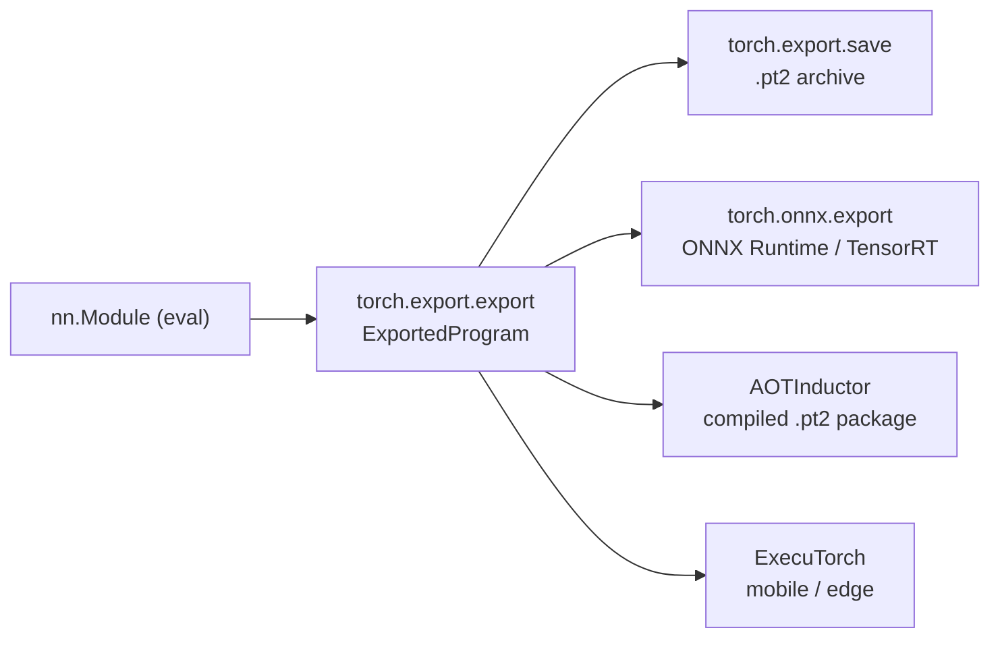

# Learn PyTorch 🔥

<div align="center">

[](https://opensource.org/licenses/MIT)
[](https://www.python.org/)
[](https://pytorch.org/)
[](https://pytorch.org/get-started/locally/)
[](https://onnx.ai/)
[](https://github.com/TheLearningHubOrg/learn-pytorch)

**An exhaustive, production-grade masterclass from absolute zero to staff-level PyTorch deep learning engineering.**  
Master tensors and autograd, `nn.Module` design, explicit training loops, high-throughput `DataLoader` pipelines, GPU acceleration with mixed precision and `torch.compile`, multi-GPU training, transfer learning, and portable model export.

[Getting Started](#1-stage-1-absolute-beginner-foundations--tensors) • [nn.Module](#2-stage-2-building-models-with-nnmodule) • [DataLoaders](#3-stage-3-data-pipelines--dataloaders) • [Training Loops](#4-stage-4-training-loops--optimization) • [GPU & Performance](#5-stage-5-gpu-acceleration--performance-engineering) • [Transfer & Export](#6-stage-6-transfer-learning-export--production-deployment) • [Staff Handbook](#7-stage-7-staff-ml-engineer-interview-handbook--cheatsheet)

<br/>

<a href="https://www.buymeacoffee.com/manthanank">
  
</a>

</div>

---

## 🗺️ 7-Stage Pedagogical Roadmap



| Stage | Domain Focus | Core Concepts & Production Outcomes |
| :--- | :--- | :--- |
| **Stage 1** | **Tensors & Autograd Foundations** | Installation per accelerator, `torch.Tensor` dtypes and devices, broadcasting, views vs copies, strides, `requires_grad`, `backward()`, the dynamic graph. |
| **Stage 2** | **Building Models with `nn.Module`** | `__init__`/`forward` contract, parameter registration, `nn.Sequential`, convolution shape arithmetic, logits and `CrossEntropyLoss`, `state_dict`, buffers. |
| **Stage 3** | **Data Pipelines & DataLoaders** | Map-style `Dataset`, `DataLoader` batching, `num_workers`, `pin_memory`, custom `collate_fn`, `torchvision.transforms.v2`, `IterableDataset` sharding. |
| **Stage 4** | **Training Loops & Optimization** | The canonical five-step loop, `AdamW`, LR warmup and cosine schedules, `inference_mode`, checkpointing, early stopping, clipping, accumulation, determinism. |
| **Stage 5** | **GPU Acceleration & Performance** | Device placement, async CUDA semantics, `torch.autocast` with bf16/fp16, `GradScaler`, `torch.compile`, `torch.profiler`, DDP with `torchrun`, FSDP2 `fully_shard`. |
| **Stage 6** | **Transfer Learning, Export & Deployment** | Pretrained backbones, freezing and discriminative LRs, `torch.export` with dynamic shapes, ONNX, AOTInductor, `torchao` quantization, containerized serving. |
| **Stage 7** | **Staff ML Engineer Interview Handbook** | 40 staff-level scenario Q&As, memory math for large models, debugging NaNs and OOMs, distributed failure modes, enterprise cheatsheet. |

---

## 📋 Table of Contents
- [1. Stage 1: Absolute Beginner Foundations & Tensors](#1-stage-1-absolute-beginner-foundations--tensors)
  - [1.1 Installation & Environment Setup](#11-installation--environment-setup)
  - [1.2 Tensors, dtypes & Devices](#12-tensors-dtypes--devices)
  - [1.3 Broadcasting, Views & Memory Layout](#13-broadcasting-views--memory-layout)
  - [1.4 Autograd & The Dynamic Computation Graph](#14-autograd--the-dynamic-computation-graph)
- [2. Stage 2: Building Models with nn.Module](#2-stage-2-building-models-with-nnmodule)
  - [2.1 Anatomy of an nn.Module](#21-anatomy-of-an-nnmodule)
  - [2.2 Layers, Containers & Shape Arithmetic](#22-layers-containers--shape-arithmetic)
  - [2.3 Loss Functions, Logits & Activations](#23-loss-functions-logits--activations)
  - [2.4 Parameters, Buffers & state_dict](#24-parameters-buffers--state_dict)
- [3. Stage 3: Data Pipelines & DataLoaders](#3-stage-3-data-pipelines--dataloaders)
  - [3.1 The Dataset Protocol](#31-the-dataset-protocol)
  - [3.2 DataLoader Internals: Batching, Workers & Pinned Memory](#32-dataloader-internals-batching-workers--pinned-memory)
  - [3.3 Transforms & Augmentation](#33-transforms--augmentation)
  - [3.4 Streaming with IterableDataset](#34-streaming-with-iterabledataset)
- [4. Stage 4: Training Loops & Optimization](#4-stage-4-training-loops--optimization)
  - [4.1 The Canonical Training Loop](#41-the-canonical-training-loop)
  - [4.2 Optimizers & Learning-Rate Schedules](#42-optimizers--learning-rate-schedules)
  - [4.3 Evaluation, Checkpointing & Early Stopping](#43-evaluation-checkpointing--early-stopping)
  - [4.4 Gradient Clipping, Accumulation & Reproducibility](#44-gradient-clipping-accumulation--reproducibility)
- [5. Stage 5: GPU Acceleration & Performance Engineering](#5-stage-5-gpu-acceleration--performance-engineering)
  - [5.1 Devices & Host-Device Transfers](#51-devices--host-device-transfers)
  - [5.2 Mixed Precision with torch.amp](#52-mixed-precision-with-torchamp)
  - [5.3 torch.compile & The Inductor Backend](#53-torchcompile--the-inductor-backend)
  - [5.4 Profiling & Memory Debugging](#54-profiling--memory-debugging)
  - [5.5 Multi-GPU Training: DDP & FSDP2](#55-multi-gpu-training-ddp--fsdp2)
- [6. Stage 6: Transfer Learning, Export & Production Deployment](#6-stage-6-transfer-learning-export--production-deployment)
  - [6.1 Transfer Learning with Pretrained Backbones](#61-transfer-learning-with-pretrained-backbones)
  - [6.2 Freezing, Fine-Tuning & Discriminative Learning Rates](#62-freezing-fine-tuning--discriminative-learning-rates)
  - [6.3 Model Export: torch.export, ONNX & AOTInductor](#63-model-export-torchexport-onnx--aotinductor)
  - [6.4 Quantization & Inference Optimization](#64-quantization--inference-optimization)
  - [6.5 Serving & Containerized Deployment](#65-serving--containerized-deployment)
  - [6.6 Running the Companion Project](#66-running-the-companion-project)
- [7. Stage 7: Staff ML Engineer Interview Handbook & Cheatsheet](#7-stage-7-staff-ml-engineer-interview-handbook--cheatsheet)
  - [7.1 Enterprise Production Cheatsheet](#71-enterprise-production-cheatsheet)
  - [7.2 Staff & Principal Architect Interview Q&A (40 Scenarios)](#72-staff--principal-architect-interview-qa-40-scenarios)
- [🤝 Contributing](#-contributing)
- [📄 License](#-license)

---

## 1. Stage 1: Absolute Beginner Foundations & Tensors

PyTorch is a Python-first deep learning framework built around two ideas: an n-dimensional array type (`torch.Tensor`) that can live on a CPU or an accelerator, and an automatic differentiation engine (`torch.autograd`) that records operations as they run so it can compute gradients afterwards. Everything else, from `nn.Module` to distributed training, is built on these two primitives.

### 1.1 Installation & Environment Setup

PyTorch publishes separate wheels per accelerator. The selector on the official "Get Started" page produces the exact command for your platform; the shapes of those commands are shown below.

```bash
# 1. Create an isolated environment (Python 3.10+)
python -m venv .venv
source .venv/bin/activate            # Windows: .venv\Scripts\activate

# 2a. CPU-only wheels (small download, ideal for laptops and CI)
pip install torch --index-url https://download.pytorch.org/whl/cpu

# 2b. NVIDIA GPU wheels: pick the CUDA tag the selector recommends (e.g. cu128, cu130)
pip install torch torchvision --index-url https://download.pytorch.org/whl/cu128

# 2c. macOS (Apple Silicon): the default PyPI wheel already includes the MPS backend
pip install torch torchvision

# 3. Verify the install and the accelerator
python -c "import torch; print(torch.__version__, torch.cuda.is_available(), torch.backends.mps.is_available())"
```

Key facts to internalise early:

1. **The CUDA runtime ships inside the wheel.** You need a recent NVIDIA driver, not a system-wide CUDA toolkit, unless you compile custom extensions.
2. **ROCm (AMD) builds reuse the `torch.cuda` API.** Code written against `"cuda"` runs unchanged on supported AMD GPUs.
3. **Pin versions in production.** `torch`, `torchvision` and `torchaudio` are released together and must match; mixing releases is the most common source of `undefined symbol` import errors.

### 1.2 Tensors, dtypes & Devices

A tensor carries four properties you will check constantly: `shape`, `dtype`, `device` and `requires_grad`.

```python
import torch

# 1. Creation
a = torch.tensor([[1.0, 2.0], [3.0, 4.0]])      # from Python data, infers float32
b = torch.zeros(2, 3)                            # filled constructors
c = torch.arange(0, 10, 2)                       # int64: tensor([0, 2, 4, 6, 8])
d = torch.randn(4, 4, generator=torch.Generator().manual_seed(42))

print(a.shape, a.dtype, a.device)                # torch.Size([2, 2]) torch.float32 cpu

# 2. dtype conversion: int64 and float32 promote to float32 when combined
labels = torch.tensor([0, 2, 1])                 # int64, what CrossEntropyLoss expects
half = a.to(torch.bfloat16)                      # reduced precision copy

# 3. Device placement
device = "cuda" if torch.cuda.is_available() else "cpu"
x = torch.randn(3, 3, device=device)             # allocate directly on the device
y = a.to(device)                                 # copy an existing tensor

# 4. Elementwise ops, reductions and matrix multiply
z = (a * 2 + 1).sum(dim=0)                       # tensor([10., 14.])
m = a @ a.T                                      # same as torch.matmul(a, a.T)

# 5. NumPy interop shares memory on CPU (no copy)
import numpy as np
arr = np.ones(3, dtype=np.float32)
t = torch.from_numpy(arr)
arr[0] = 5.0
print(t)                                         # tensor([5., 1., 1.])
```

| dtype | Bytes | Typical use |
| :--- | :--- | :--- |
| `torch.float32` | 4 | Default for parameters and CPU math |
| `torch.bfloat16` | 2 | Mixed-precision training on modern GPUs; same exponent range as fp32 |
| `torch.float16` | 2 | Mixed precision on older GPUs; needs loss scaling |
| `torch.int64` | 8 | Class indices, token ids |
| `torch.bool` | 1 | Masks |

Operations between tensors on different devices raise an error instead of copying silently. That strictness is deliberate: implicit transfers are the main hidden cost in GPU code.

### 1.3 Broadcasting, Views & Memory Layout

**Broadcasting** lets tensors of different shapes combine without copies. Shapes are compared from the trailing dimension backwards; each pair must be equal, or one of them must be 1.

```
a: (3, 1)        a: (8, 1, 6)
b:    (4,)       b:    (5, 1)
-> (3, 4)        -> (8, 5, 6)
```

```python
import torch

row_means = torch.randn(32, 10).mean(dim=1, keepdim=True)   # (32, 1)
centred = torch.randn(32, 10) - row_means                   # (32, 10) via broadcasting

# Views share storage; they only change shape/stride metadata
x = torch.arange(12)
v = x.view(3, 4)
v[0, 0] = 100
print(x[0])                    # tensor(100): same memory

# transpose() makes a non-contiguous view
t = v.T
print(t.is_contiguous())       # False
# t.view(12) would raise; reshape() copies when it has to
flat = t.reshape(12)
flat2 = t.contiguous().view(12)

print(v.stride(), t.stride())  # (4, 1) (1, 4)
```

A **stride** tells PyTorch how many elements to skip in storage to move one step along each dimension. Transpose swaps strides instead of moving data, which is why it is free, and why the result is no longer laid out row by row.

### 1.4 Autograd & The Dynamic Computation Graph

When a tensor has `requires_grad=True`, every operation on it records a node in a graph. Calling `backward()` on a scalar walks that graph in reverse, applying the chain rule and accumulating results into each leaf's `.grad`.



```python
import torch

# 1. Scalar example: y = x^3 + 2x, so dy/dx = 3x^2 + 2
x = torch.tensor(2.0, requires_grad=True)
y = x**3 + 2 * x
y.backward()
print(x.grad)                  # tensor(14.)

# 2. Gradients ACCUMULATE: a second backward adds to .grad
y = x**3 + 2 * x
y.backward()
print(x.grad)                  # tensor(28.)
x.grad = None                  # reset (optimizers do this via zero_grad)

# 3. Manual gradient descent on a linear model, no nn.Module
torch.manual_seed(0)
X = torch.randn(100, 1)
y_true = 3 * X + 0.5 + 0.1 * torch.randn(100, 1)
w = torch.zeros(1, requires_grad=True)
b = torch.zeros(1, requires_grad=True)

for step in range(200):
    loss = ((X * w + b - y_true) ** 2).mean()
    loss.backward()
    with torch.no_grad():      # updates must not be recorded in the graph
        w -= 0.1 * w.grad
        b -= 0.1 * b.grad
        w.grad = None
        b.grad = None

print(round(w.item(), 2), round(b.item(), 2))   # roughly 3.0 0.5
```

The graph is **define-by-run**: it is rebuilt on every forward pass, so ordinary Python `if` statements and loops shape the model. The graph is freed after `backward()` unless you pass `retain_graph=True`. Use `tensor.detach()` to cut a tensor out of the graph, and `torch.no_grad()` (or `torch.inference_mode()`) to stop recording altogether.

---

## 2. Stage 2: Building Models with nn.Module

### 2.1 Anatomy of an nn.Module

An `nn.Module` is a container that owns parameters, sub-modules and buffers, and defines `forward()`. Assigning an `nn.Parameter` or another module as an attribute inside `__init__` registers it automatically, which is how `model.parameters()`, `.to(device)` and `state_dict()` find everything.

```python
import torch
from torch import nn


class ResidualMLP(nn.Module):
    """Linear -> GELU -> Linear with a skip connection and LayerNorm."""

    def __init__(self, dim: int, hidden: int, num_classes: int) -> None:
        super().__init__()                       # must run before assigning layers
        self.norm = nn.LayerNorm(dim)
        self.fc1 = nn.Linear(dim, hidden)
        self.fc2 = nn.Linear(hidden, dim)
        self.act = nn.GELU()
        self.head = nn.Linear(dim, num_classes)
        self.scale = nn.Parameter(torch.ones(1))  # a learnable scalar

    def forward(self, x: torch.Tensor) -> torch.Tensor:
        residual = x
        x = self.fc2(self.act(self.fc1(self.norm(x))))
        x = residual + self.scale * x
        return self.head(x)


model = ResidualMLP(dim=16, hidden=64, num_classes=4)
out = model(torch.randn(8, 16))                  # call the module, not .forward()
print(out.shape)                                 # torch.Size([8, 4])

for name, p in model.named_parameters():
    print(f"{name:12s} {tuple(p.shape)}")
print(sum(p.numel() for p in model.parameters()))
```

Always call `model(x)` rather than `model.forward(x)`: `__call__` runs registered hooks and is what `torch.compile` and export expect. Sub-modules held in a plain Python `list` are **not** registered; use `nn.ModuleList` or `nn.ModuleDict`.

### 2.2 Layers, Containers & Shape Arithmetic

For a convolution or pooling layer, the output spatial size is:

$$H_{out} = \left\lfloor \frac{H_{in} + 2p - k}{s} \right\rfloor + 1$$

With a 28x28 input, `kernel_size=3`, `padding=1`, `stride=1`, the size stays at 28; a `MaxPool2d(2)` then halves it to 14.

```python
import torch
from torch import nn

cnn = nn.Sequential(
    nn.Conv2d(1, 8, kernel_size=3, padding=1),    # (N, 8, 28, 28)
    nn.ReLU(),
    nn.MaxPool2d(2),                              # (N, 8, 14, 14)
    nn.Conv2d(8, 16, kernel_size=3, padding=1),   # (N, 16, 14, 14)
    nn.ReLU(),
    nn.MaxPool2d(2),                              # (N, 16, 7, 7)
    nn.Flatten(),                                 # (N, 784)
    nn.Linear(16 * 7 * 7, 10),
)

# Debug shapes layer by layer instead of guessing
x = torch.randn(2, 1, 28, 28)
for layer in cnn:
    x = layer(x)
    print(f"{layer.__class__.__name__:10s} -> {tuple(x.shape)}")

# Or let LazyLinear infer in_features on the first call
lazy_head = nn.Sequential(nn.Flatten(), nn.LazyLinear(10))
lazy_head(torch.randn(2, 16, 7, 7))
print(lazy_head[1].in_features)                  # 784
```

PyTorch image layers use **NCHW** (batch, channels, height, width). Recurrent and attention layers default to `(seq, batch, feature)` unless you pass `batch_first=True`, a frequent source of silent bugs.

### 2.3 Loss Functions, Logits & Activations

| Task | Final layer output | Loss | Target format |
| :--- | :--- | :--- | :--- |
| Multi-class | raw logits `(N, C)` | `nn.CrossEntropyLoss` | int64 class ids `(N,)` |
| Multi-label / binary | raw logits `(N, C)` | `nn.BCEWithLogitsLoss` | float 0/1 `(N, C)` |
| Regression | raw values | `nn.MSELoss` / `nn.HuberLoss` | float `(N, ...)` |

```python
import torch
from torch import nn

logits = torch.tensor([[2.0, 0.5, -1.0], [0.1, 0.2, 3.0]])
targets = torch.tensor([0, 2])

# CORRECT: CrossEntropyLoss applies log-softmax internally
loss = nn.CrossEntropyLoss(label_smoothing=0.1)(logits, targets)

# WRONG: softmax first, then CrossEntropyLoss = double softmax, flattened gradients
bad = nn.CrossEntropyLoss()(logits.softmax(dim=1), targets)

# Probabilities only at inference time
probs = logits.softmax(dim=1)
preds = probs.argmax(dim=1)

# Imbalanced binary problem: up-weight the rare positive class
bce = nn.BCEWithLogitsLoss(pos_weight=torch.tensor([5.0]))
print(loss.item(), bce(torch.randn(4, 1), torch.ones(4, 1)).item())
```

The "with logits" losses fuse the activation and the log into one numerically stable kernel. Applying `sigmoid` or `softmax` yourself first throws that stability away.

### 2.4 Parameters, Buffers & state_dict

A **buffer** is state that should move with the model and be saved, but not be trained, such as BatchNorm running statistics or a fixed positional table.

```python
import torch
from torch import nn


class Standardize(nn.Module):
    def __init__(self, mean: torch.Tensor, std: torch.Tensor) -> None:
        super().__init__()
        self.register_buffer("mean", mean)                     # saved, moved, not trained
        self.register_buffer("std", std)
        self.register_buffer("cache", torch.zeros(1), persistent=False)  # moved, not saved

    def forward(self, x: torch.Tensor) -> torch.Tensor:
        return (x - self.mean) / self.std


model = nn.Sequential(Standardize(torch.zeros(4), torch.ones(4)), nn.Linear(4, 2))
print(list(model.state_dict().keys()))
# ['0.mean', '0.std', '1.weight', '1.bias']

# Custom initialisation applied recursively
def init_weights(m: nn.Module) -> None:
    if isinstance(m, nn.Linear):
        nn.init.kaiming_normal_(m.weight, nonlinearity="relu")
        nn.init.zeros_(m.bias)

model.apply(init_weights)

# Save and restore weights only
torch.save(model.state_dict(), "model.pt")
model.load_state_dict(torch.load("model.pt", weights_only=True))
```

Save the `state_dict`, never the whole pickled module: a pickled module is tied to your exact class layout and import paths, and loading arbitrary pickles executes code. Recent PyTorch releases default `torch.load` to `weights_only=True` for that reason.

---

## 3. Stage 3: Data Pipelines & DataLoaders



### 3.1 The Dataset Protocol

A map-style dataset implements `__len__` and `__getitem__`. Keep `__getitem__` cheap and side-effect free, because it runs in worker processes.

```python
from pathlib import Path

import torch
from torch.utils.data import Dataset


class CsvRegressionDataset(Dataset):
    """Each row: feature_1, ..., feature_n, target"""

    def __init__(self, path: str | Path) -> None:
        rows = [
            [float(v) for v in line.split(",")]
            for line in Path(path).read_text().splitlines()[1:]   # skip header
            if line.strip()
        ]
        data = torch.tensor(rows, dtype=torch.float32)
        # Store tensors, not lists of Python floats (see the worker memory note in 3.2)
        self.features = data[:, :-1]
        self.targets = data[:, -1:]

    def __len__(self) -> int:
        return len(self.targets)

    def __getitem__(self, idx: int) -> tuple[torch.Tensor, torch.Tensor]:
        return self.features[idx], self.targets[idx]
```

For in-memory tensors, `torch.utils.data.TensorDataset(features, labels)` does the same job in one line. `random_split` with a seeded `torch.Generator` gives a reproducible train/validation split.

### 3.2 DataLoader Internals: Batching, Workers & Pinned Memory

```python
import torch
from torch.nn.utils.rnn import pad_sequence
from torch.utils.data import DataLoader, Dataset


class TokenDataset(Dataset):
    def __init__(self, sequences: list[list[int]], labels: list[int]) -> None:
        self.sequences = [torch.tensor(s) for s in sequences]
        self.labels = torch.tensor(labels)

    def __len__(self) -> int:
        return len(self.labels)

    def __getitem__(self, idx: int):
        return self.sequences[idx], self.labels[idx]


def pad_collate(batch):
    """Variable-length sequences -> padded (N, T) tensor plus a lengths vector."""
    seqs, labels = zip(*batch)
    lengths = torch.tensor([len(s) for s in seqs])
    padded = pad_sequence(seqs, batch_first=True, padding_value=0)
    return padded, lengths, torch.stack(labels)


def main() -> None:
    ds = TokenDataset([[5, 3, 9], [7, 1], [4, 4, 4, 4]], [1, 0, 1])
    loader = DataLoader(
        ds,
        batch_size=2,
        shuffle=True,
        num_workers=2,             # parallel loading in separate processes
        pin_memory=torch.cuda.is_available(),
        persistent_workers=True,   # keep workers alive between epochs
        prefetch_factor=4,         # batches queued per worker (needs num_workers > 0)
        collate_fn=pad_collate,
        drop_last=False,
    )
    for padded, lengths, labels in loader:
        print(padded.shape, lengths.tolist(), labels.tolist())


if __name__ == "__main__":         # required wherever workers are spawned, not forked
    main()
```

Production tuning rules:

1. **`num_workers`**: start around the number of physical cores divided by GPUs per node, then measure. If GPU utilisation is low and the CPU is busy decoding, add workers.
2. **`pin_memory=True` + `.to(device, non_blocking=True)`** lets host-to-device copies overlap with compute.
3. **Worker memory growth**: with the `fork` start method, workers share the parent's pages copy-on-write, and touching Python objects updates their reference counts, which defeats copy-on-write. A dataset holding millions of Python lists or dicts can appear to "leak" memory per worker. Store data as tensors or NumPy arrays instead.
4. **Random augmentation in workers** draws from a per-worker seed that PyTorch derives for you; libraries with their own global RNG need a `worker_init_fn`.

### 3.3 Transforms & Augmentation

`torchvision.transforms.v2` operates on tensors and on images, bounding boxes and masks together, so geometric augmentations stay consistent across targets.

```python
import torch
from torchvision.transforms import v2

IMAGENET_MEAN = [0.485, 0.456, 0.406]
IMAGENET_STD = [0.229, 0.224, 0.225]

train_tf = v2.Compose([
    v2.ToImage(),                                  # PIL / ndarray -> tv_tensors.Image
    v2.RandomResizedCrop(224, antialias=True),
    v2.RandomHorizontalFlip(p=0.5),
    v2.ColorJitter(brightness=0.2, contrast=0.2),
    v2.ToDtype(torch.float32, scale=True),         # uint8 [0,255] -> float [0,1]
    v2.Normalize(IMAGENET_MEAN, IMAGENET_STD),
])

eval_tf = v2.Compose([
    v2.ToImage(),
    v2.Resize(256, antialias=True),
    v2.CenterCrop(224),
    v2.ToDtype(torch.float32, scale=True),
    v2.Normalize(IMAGENET_MEAN, IMAGENET_STD),
])

img = torch.randint(0, 256, (3, 300, 400), dtype=torch.uint8)
print(train_tf(img).shape, eval_tf(img).shape)      # both (3, 224, 224)
```

Augment only the training split. Validation and test transforms must be deterministic, or your metrics will wobble between runs.

### 3.4 Streaming with IterableDataset

When data does not fit in memory, or arrives from object storage or a message queue, use an `IterableDataset`. Each worker receives its own copy, so you must shard the stream yourself or every worker yields duplicates.

```python
import math

import torch
from torch.utils.data import DataLoader, IterableDataset, get_worker_info


class RangeStream(IterableDataset):
    def __init__(self, start: int, end: int) -> None:
        self.start, self.end = start, end

    def __iter__(self):
        info = get_worker_info()
        if info is None:                      # single-process loading
            lo, hi = self.start, self.end
        else:                                 # split the range across workers
            per_worker = math.ceil((self.end - self.start) / info.num_workers)
            lo = self.start + info.id * per_worker
            hi = min(lo + per_worker, self.end)
        for i in range(lo, hi):
            yield torch.tensor([float(i)])


if __name__ == "__main__":
    loader = DataLoader(RangeStream(0, 10), batch_size=4, num_workers=2)
    print(sorted(int(v) for batch in loader for v in batch.flatten()))   # 0..9, no duplicates
```

`shuffle=True` is not allowed with an `IterableDataset`; shuffle with a buffer inside `__iter__`, or pre-shuffle the shards.

---

## 4. Stage 4: Training Loops & Optimization

### 4.1 The Canonical Training Loop

PyTorch deliberately leaves the loop to you. Every loop, from a toy MLP to a large language model, is the same five steps:

```
for batch in loader:
    1. move batch to device
    2. logits = model(x)            forward
    3. loss = loss_fn(logits, y)
    4. optimizer.zero_grad(); loss.backward()
    5. optimizer.step()             update
```

```python
import torch
from torch import nn
from torch.utils.data import DataLoader, TensorDataset, random_split

# 1. Data: three Gaussian blobs, 2 features
torch.manual_seed(0)
centres = torch.tensor([[3.0, 0.0], [-1.5, 2.6], [-1.5, -2.6]])
labels = torch.randint(0, 3, (1200,))
features = centres[labels] + torch.randn(1200, 2)
train_ds, val_ds = random_split(TensorDataset(features, labels), [1000, 200],
                                generator=torch.Generator().manual_seed(0))
train_loader = DataLoader(train_ds, batch_size=64, shuffle=True)
val_loader = DataLoader(val_ds, batch_size=256)

# 2. Model, loss, optimizer
device = torch.device("cuda" if torch.cuda.is_available() else "cpu")
model = nn.Sequential(nn.Linear(2, 64), nn.ReLU(), nn.Linear(64, 3)).to(device)
loss_fn = nn.CrossEntropyLoss()
optimizer = torch.optim.AdamW(model.parameters(), lr=1e-2, weight_decay=1e-4)

# 3. Train / evaluate
for epoch in range(10):
    model.train()
    running = 0.0
    for x, y in train_loader:
        x, y = x.to(device), y.to(device)
        loss = loss_fn(model(x), y)
        optimizer.zero_grad(set_to_none=True)
        loss.backward()
        optimizer.step()
        running += loss.item() * len(y)      # .item() returns a Python float, no graph kept

    model.eval()
    correct = 0
    with torch.inference_mode():
        for x, y in val_loader:
            correct += (model(x.to(device)).argmax(1) == y.to(device)).sum().item()
    print(f"epoch {epoch}: loss={running / len(train_ds):.4f} "
          f"val_acc={correct / len(val_ds):.3f}")
```

This is exactly the loop in the companion package's `src/learn_pytorch/train.py`, split into `train_one_epoch()` and `evaluate()` so each half can be tested.

### 4.2 Optimizers & Learning-Rate Schedules

| Optimizer | When to use |
| :--- | :--- |
| `SGD(momentum=0.9, nesterov=True)` | CNNs on large vision datasets; strong generalisation with a good schedule |
| `AdamW` | Default for transformers and most new work; decoupled weight decay |
| `Adam` | Legacy; its `weight_decay` is L2 regularisation, which interacts badly with adaptive steps |

```python
import torch
from torch import nn
from torch.optim.lr_scheduler import CosineAnnealingLR, LinearLR, SequentialLR

model = nn.Linear(10, 2)

# Do not decay biases and norm weights: a common, measurable win
decay, no_decay = [], []
for name, p in model.named_parameters():
    (no_decay if p.ndim < 2 else decay).append(p)

optimizer = torch.optim.AdamW(
    [{"params": decay, "weight_decay": 0.05},
     {"params": no_decay, "weight_decay": 0.0}],
    lr=3e-4, betas=(0.9, 0.95),
)

# Linear warmup for 500 steps, then cosine decay; stepped once PER BATCH
total_steps, warmup = 10_000, 500
scheduler = SequentialLR(
    optimizer,
    schedulers=[
        LinearLR(optimizer, start_factor=0.01, total_iters=warmup),
        CosineAnnealingLR(optimizer, T_max=total_steps - warmup, eta_min=1e-6),
    ],
    milestones=[warmup],
)

for step in range(3):
    optimizer.step()        # optimizer first...
    scheduler.step()        # ...then the scheduler
    print(scheduler.get_last_lr())
```

Calling `scheduler.step()` before `optimizer.step()` skips the first value of the schedule and triggers a warning. Decide once whether a scheduler is per-batch or per-epoch and document it next to the code.

### 4.3 Evaluation, Checkpointing & Early Stopping

`model.eval()` changes layer **behaviour** (dropout off, BatchNorm uses running stats). `torch.inference_mode()` changes **autograd** (nothing is recorded, tensors cannot later join a graph). You need both for evaluation.

```python
from pathlib import Path

import torch


def save_training_state(path: Path, model, optimizer, scheduler, epoch: int, best: float) -> None:
    """Everything needed to resume exactly, not just the weights."""
    torch.save({
        "model": model.state_dict(),
        "optimizer": optimizer.state_dict(),     # Adam moments live here
        "scheduler": scheduler.state_dict(),
        "epoch": epoch,
        "best_val_loss": best,
        "rng_cpu": torch.get_rng_state(),
    }, path)


def load_training_state(path: Path, model, optimizer, scheduler) -> tuple[int, float]:
    state = torch.load(path, map_location="cpu", weights_only=True)
    model.load_state_dict(state["model"])
    optimizer.load_state_dict(state["optimizer"])
    scheduler.load_state_dict(state["scheduler"])
    torch.set_rng_state(state["rng_cpu"])
    return state["epoch"] + 1, state["best_val_loss"]


class EarlyStopping:
    def __init__(self, patience: int = 5, min_delta: float = 1e-4) -> None:
        self.patience, self.min_delta = patience, min_delta
        self.best, self.bad_epochs = float("inf"), 0

    def step(self, val_loss: float) -> bool:
        """Return True when training should stop."""
        if val_loss < self.best - self.min_delta:
            self.best, self.bad_epochs = val_loss, 0
            return False
        self.bad_epochs += 1
        return self.bad_epochs >= self.patience
```

Write checkpoints to a temporary file and rename them into place, so a pre-empted spot instance never leaves a half-written file as your "latest" checkpoint.

### 4.4 Gradient Clipping, Accumulation & Reproducibility

```python
import os
import random

import numpy as np
import torch


def seed_everything(seed: int = 0, deterministic: bool = False) -> None:
    random.seed(seed)
    np.random.seed(seed)
    torch.manual_seed(seed)                  # seeds CPU and all CUDA devices
    if deterministic:
        os.environ["CUBLAS_WORKSPACE_CONFIG"] = ":4096:8"
        torch.backends.cudnn.benchmark = False
        torch.use_deterministic_algorithms(True)   # raise on non-deterministic kernels


def train_with_accumulation(model, loader, loss_fn, optimizer, device, accum_steps=4, max_norm=1.0):
    """Effective batch = loader batch size x accum_steps."""
    model.train()
    optimizer.zero_grad(set_to_none=True)
    for i, (x, y) in enumerate(loader):
        x, y = x.to(device), y.to(device)
        loss = loss_fn(model(x), y) / accum_steps    # average across micro-batches
        loss.backward()                              # gradients accumulate in .grad
        if (i + 1) % accum_steps == 0:
            torch.nn.utils.clip_grad_norm_(model.parameters(), max_norm)
            optimizer.step()
            optimizer.zero_grad(set_to_none=True)
```

1. **Clip after the full accumulated gradient**, right before `step()`; clipping each micro-batch changes the maths.
2. **Divide the loss by `accum_steps`**, or the effective learning rate grows with the accumulation factor.
3. **Determinism costs speed.** Enable it to chase a bug, not by default in production training.

---

## 5. Stage 5: GPU Acceleration & Performance Engineering

### 5.1 Devices & Host-Device Transfers

CUDA calls are **asynchronous**: Python queues kernels and returns immediately. The CPU only waits at synchronisation points, such as `.item()`, `.cpu()`, `print(tensor)`, or `torch.cuda.synchronize()`.

```python
import time

import torch

device = torch.device("cuda" if torch.cuda.is_available() else "cpu")
a = torch.randn(4096, 4096, device=device)

# WRONG timing on GPU: measures only how long it took to enqueue the kernel
t0 = time.perf_counter()
b = a @ a
naive = time.perf_counter() - t0

# RIGHT: use CUDA events (or synchronize before reading the clock)
if device.type == "cuda":
    start, end = torch.cuda.Event(enable_timing=True), torch.cuda.Event(enable_timing=True)
    start.record()
    b = a @ a
    end.record()
    torch.cuda.synchronize()
    print(f"matmul: {start.elapsed_time(end):.2f} ms")

# Overlap copies with compute: pinned host memory + non_blocking
host = torch.randn(256, 3, 224, 224).pin_memory() if device.type == "cuda" else torch.randn(1)
batch = host.to(device, non_blocking=True)
```

Hidden sync points inside the training loop, most often `loss.item()` on every step, stall the GPU pipeline. Log every N steps, or accumulate on-device and read once per epoch.

### 5.2 Mixed Precision with torch.amp

```
fp32  : 1 sign | 8 exponent | 23 mantissa   range ~1e38, precise
bf16  : 1 sign | 8 exponent |  7 mantissa   same range as fp32, less precise
fp16  : 1 sign | 5 exponent | 10 mantissa   range ~6.5e4, gradients can underflow
```

`torch.autocast` runs matmuls and convolutions in reduced precision while keeping numerically sensitive ops (softmax, reductions, losses) in fp32. Weights stay fp32.

```python
import torch
from torch import nn

device = "cuda" if torch.cuda.is_available() else "cpu"
model = nn.Sequential(nn.Linear(512, 512), nn.ReLU(), nn.Linear(512, 10)).to(device)
optimizer = torch.optim.AdamW(model.parameters(), lr=1e-3)
loss_fn = nn.CrossEntropyLoss()
x = torch.randn(64, 512, device=device)
y = torch.randint(0, 10, (64,), device=device)

# Option A: bf16 (Ampere or newer, and CPU) - no scaler needed
with torch.autocast(device_type=device, dtype=torch.bfloat16):
    loss = loss_fn(model(x), y)
loss.backward()
optimizer.step()
optimizer.zero_grad(set_to_none=True)

# Option B: fp16 - scale the loss so small gradients do not flush to zero
if device == "cuda":
    scaler = torch.amp.GradScaler("cuda")
    with torch.autocast(device_type="cuda", dtype=torch.float16):
        loss = loss_fn(model(x), y)
    scaler.scale(loss).backward()
    scaler.unscale_(optimizer)                         # so clipping sees true gradient norms
    torch.nn.utils.clip_grad_norm_(model.parameters(), 1.0)
    scaler.step(optimizer)                             # skips the step if inf/NaN found
    scaler.update()
    optimizer.zero_grad(set_to_none=True)
```

The older `torch.cuda.amp.autocast` and `torch.cuda.amp.GradScaler` spellings are deprecated in favour of the device-generic `torch.autocast` and `torch.amp.GradScaler("cuda")`. On Ampere or newer, also call `torch.set_float32_matmul_precision("high")` to let fp32 matmuls use TF32 tensor cores.

### 5.3 torch.compile & The Inductor Backend

`torch.compile` captures Python bytecode with TorchDynamo, lowers it to an FX graph, and hands it to a backend (Inductor by default) that generates fused Triton kernels on GPU or C++/OpenMP code on CPU.



```python
import torch
from torch import nn

model = nn.Sequential(nn.Linear(1024, 4096), nn.GELU(), nn.Linear(4096, 1024))
compiled = torch.compile(model)                       # default mode
# torch.compile(model, mode="reduce-overhead")        # CUDA graphs: small batches, fixed shapes
# torch.compile(model, mode="max-autotune")           # longer compile, searches kernel configs
# torch.compile(model, dynamic=True)                  # expect varying input shapes

x = torch.randn(32, 1024)
out = compiled(x)          # first call compiles (slow), later calls reuse the kernels

# Diagnose graph breaks and recompilations:
#   TORCH_LOGS="graph_breaks,recompiles" python train.py
#   torch._dynamo.explain(model)(x)
```

1. **Graph breaks** happen on things Dynamo cannot trace (some third-party calls, data-dependent Python control flow, `print` of tensor values). Each break splits the graph and limits fusion.
2. **Recompilations** happen when guards fail, for example a new input shape or dtype. Mark dynamic dimensions or pad to buckets to keep the cache hot.
3. **Measure after warm-up.** Compile time is real; for short jobs it can outweigh the speed-up.

### 5.4 Profiling & Memory Debugging

```python
import torch
from torch import nn
from torch.profiler import ProfilerActivity, profile, record_function, schedule

model = nn.Sequential(nn.Linear(512, 2048), nn.ReLU(), nn.Linear(2048, 10))
x = torch.randn(128, 512)
activities = [ProfilerActivity.CPU]
if torch.cuda.is_available():
    activities.append(ProfilerActivity.CUDA)
    model, x = model.cuda(), x.cuda()

with profile(
    activities=activities,
    schedule=schedule(wait=1, warmup=1, active=3),
    record_shapes=True,
    profile_memory=True,
) as prof:
    for _ in range(5):
        with record_function("train_step"):
            model(x).sum().backward()
        prof.step()                               # advance the wait/warmup/active schedule

print(prof.key_averages().table(sort_by="self_cpu_time_total", row_limit=10))
# prof.export_chrome_trace("trace.json")  -> open in Perfetto UI

if torch.cuda.is_available():
    print(f"peak allocated: {torch.cuda.max_memory_allocated() / 2**20:.1f} MiB")
    print(torch.cuda.memory_summary(abbreviated=True))
```

When chasing an out-of-memory error, separate the four consumers: **weights**, **gradients**, **optimizer state** and **activations**. Activations scale with batch size and sequence length; the other three scale with parameter count. Activation checkpointing (`torch.utils.checkpoint.checkpoint`) trades recomputation for activation memory.

### 5.5 Multi-GPU Training: DDP & FSDP2



```python
# train_ddp.py  ->  torchrun --nproc_per_node=4 train_ddp.py
import os

import torch
import torch.distributed as dist
from torch import nn
from torch.nn.parallel import DistributedDataParallel as DDP
from torch.utils.data import DataLoader, TensorDataset
from torch.utils.data.distributed import DistributedSampler


def main() -> None:
    # 1. torchrun sets RANK, LOCAL_RANK and WORLD_SIZE for every process
    dist.init_process_group(backend="nccl")
    local_rank = int(os.environ["LOCAL_RANK"])
    torch.cuda.set_device(local_rank)

    # 2. Each rank sees a distinct slice of the data
    ds = TensorDataset(torch.randn(10_000, 32), torch.randint(0, 4, (10_000,)))
    sampler = DistributedSampler(ds, shuffle=True)
    loader = DataLoader(ds, batch_size=64, sampler=sampler, num_workers=4, pin_memory=True)

    # 3. Wrap the model; DDP all-reduces gradients during backward()
    model = nn.Sequential(nn.Linear(32, 128), nn.ReLU(), nn.Linear(128, 4)).cuda()
    model = DDP(model, device_ids=[local_rank])
    optimizer = torch.optim.AdamW(model.parameters(), lr=1e-3)
    loss_fn = nn.CrossEntropyLoss()

    for epoch in range(5):
        sampler.set_epoch(epoch)                 # different shuffle every epoch
        for x, y in loader:
            x, y = x.cuda(non_blocking=True), y.cuda(non_blocking=True)
            loss = loss_fn(model(x), y)
            optimizer.zero_grad(set_to_none=True)
            loss.backward()
            optimizer.step()

    # 4. Only rank 0 writes; unwrap with .module
    if dist.get_rank() == 0:
        torch.save(model.module.state_dict(), "ddp_model.pt")
    dist.destroy_process_group()


if __name__ == "__main__":
    main()
```

When the model no longer fits on one GPU, switch to FSDP2, which shards parameters, gradients and optimizer state per module:

```python
from torch.distributed.fsdp import fully_shard

# After init_process_group and moving the model to the local GPU:
for block in model.layers:          # shard each transformer block separately...
    fully_shard(block)
fully_shard(model)                  # ...then the root, which owns the leftovers
optimizer = torch.optim.AdamW(model.parameters(), lr=3e-4)   # build AFTER sharding
```

`nn.DataParallel` is single-process and multi-threaded, so it suffers from the GIL and re-scatters the model every step. Use DDP even on a single machine.

---

## 6. Stage 6: Transfer Learning, Export & Production Deployment

### 6.1 Transfer Learning with Pretrained Backbones

Pretrained networks have already learned general features (edges, textures, shapes). Replacing only the classification head lets a few thousand labelled images reach accuracy that training from scratch would need far more data for.

```python
import torch
from torch import nn
from torchvision import models

# 1. Load weights through the enum; it also carries the matching preprocessing
weights = models.ResNet18_Weights.DEFAULT
model = models.resnet18(weights=weights)
preprocess = weights.transforms()        # resize, crop, normalise exactly as in pretraining

# 2. Replace the head for a 5-class problem
num_classes = 5
model.fc = nn.Linear(model.fc.in_features, num_classes)

# 3. Feature extraction: freeze everything except the new head
for name, p in model.named_parameters():
    p.requires_grad = name.startswith("fc.")

trainable = [p for p in model.parameters() if p.requires_grad]
optimizer = torch.optim.AdamW(trainable, lr=1e-3)
print(sum(p.numel() for p in trainable), "trainable parameters")
```

### 6.2 Freezing, Fine-Tuning & Discriminative Learning Rates

```
Phase 1 (head only)          Phase 2 (full fine-tune)
[conv1][layer1..4] frozen    [conv1][layer1..2] lr 1e-5
[fc]   lr 1e-3               [layer3..4]        lr 1e-4
                             [fc]               lr 1e-3
```

```python
import torch
from torch import nn


def freeze_batchnorm(module: nn.Module) -> None:
    """Frozen BN layers must also stop updating running stats."""
    for m in module.modules():
        if isinstance(m, nn.BatchNorm2d):
            m.eval()
            for p in m.parameters():
                p.requires_grad = False


def discriminative_param_groups(model, base_lr: float = 1e-3):
    """Lower learning rates for earlier, more general layers."""
    for p in model.parameters():
        p.requires_grad = True
    return [
        {"params": list(model.conv1.parameters()) + list(model.layer1.parameters())
                   + list(model.layer2.parameters()), "lr": base_lr / 100},
        {"params": list(model.layer3.parameters()) + list(model.layer4.parameters()),
         "lr": base_lr / 10},
        {"params": model.fc.parameters(), "lr": base_lr},
    ]

# optimizer = torch.optim.AdamW(discriminative_param_groups(model), weight_decay=0.01)
# Remember: model.train() flips BN back to training mode, so call freeze_batchnorm()
# after every model.train() if you keep BN frozen.
```

With very small datasets, keep the backbone frozen. With mid-sized datasets, unfreeze progressively from the top and lower the learning rate as you go deeper; this limits **catastrophic forgetting** of the pretrained features.

### 6.3 Model Export: torch.export, ONNX & AOTInductor

`torch.export` produces a sound, whole-program graph (an `ExportedProgram`) with no Python dependency on your model code. It is the modern replacement for TorchScript, which is deprecated.



```python
import torch
from torch import nn

model = nn.Sequential(nn.Linear(2, 64), nn.ReLU(), nn.Linear(64, 3)).eval()
example = torch.randn(4, 2)

# 1. Export with a dynamic batch dimension (otherwise the shape is fixed to 4)
batch = torch.export.Dim("batch", min=1, max=4096)
program = torch.export.export(model, (example,), dynamic_shapes={"input": {0: batch}})
print(program.graph_module.code)               # inspect the captured ATen graph

# 2. Save, load and run anywhere the same PyTorch version is installed
torch.export.save(program, "model.pt2")
loaded = torch.export.load("model.pt2").module()
print(loaded(torch.randn(9, 2)).shape)         # torch.Size([9, 3])

# 3. ONNX via the dynamo-based exporter (needs the onnx and onnxscript packages)
onnx_program = torch.onnx.export(model, (example,), dynamo=True,
                                 dynamic_shapes={"input": {0: batch}})
onnx_program.save("model.onnx")

# 4. AOTInductor: ahead-of-time compiled kernels, loadable from Python or C++
pkg = torch._inductor.aoti_compile_and_package(program, package_path="model_aoti.pt2")
runner = torch._inductor.aoti_load_package(pkg)
print(runner(torch.randn(8, 2)).shape)
```

The keys in `dynamic_shapes` must match the names of `forward()`'s arguments. `nn.Sequential.forward` names its argument `input`; the companion `MLPClassifier.forward` uses `x`. Export fails loudly on data-dependent control flow; rewrite such branches with `torch.cond` or move them outside the exported module.

### 6.4 Quantization & Inference Optimization

| Technique | Accuracy impact | Speed / size gain | Effort |
| :--- | :--- | :--- | :--- |
| bf16/fp16 weights | Negligible | ~2x memory | Trivial |
| Int8 weight-only | Small | ~4x memory vs fp32; faster memory-bound layers | Low |
| Int8 dynamic activation + weight | Small to moderate | Faster CPU linear layers | Low |
| Quantization-aware training (QAT) | Smallest for low bit widths | Same as int8/int4 PTQ | High |
| Int4 weight-only | Moderate | ~8x memory; LLM decoding | Medium |

```python
# pip install torchao   (use the current stable release matching your torch version)
import torch
from torch import nn
from torchao.quantization import Int8WeightOnlyConfig, quantize_

model = nn.Sequential(nn.Linear(1024, 4096), nn.ReLU(), nn.Linear(4096, 1024)).eval()
quantize_(model, Int8WeightOnlyConfig())        # swaps Linear weights in place
model = torch.compile(model)                    # fuse dequantize into the matmul

with torch.inference_mode():
    out = model(torch.randn(8, 1024))
```

Quantization work has moved from the older `torch.ao.quantization` eager-mode APIs to the `torchao` library, which composes with `torch.compile` and `torch.export`. Always re-run your full evaluation suite after quantizing; averages can hide large regressions on rare classes.

### 6.5 Serving & Containerized Deployment

TorchServe is no longer actively maintained. Teams now usually choose among a thin FastAPI or gRPC service for simple models, NVIDIA Triton Inference Server for multi-model GPU fleets with dynamic batching, vLLM or SGLang for LLMs, and ExecuTorch for on-device inference.

```python
# serve.py  ->  uvicorn serve:app --host 0.0.0.0 --port 8000
from contextlib import asynccontextmanager

import torch
from fastapi import FastAPI
from pydantic import BaseModel

state: dict = {}


@asynccontextmanager
async def lifespan(app: FastAPI):
    torch.set_num_threads(2)                     # avoid oversubscribing CPU workers
    state["model"] = torch.export.load("artifacts/model.pt2").module()
    yield
    state.clear()


app = FastAPI(lifespan=lifespan)


class Batch(BaseModel):
    features: list[list[float]]


@app.post("/predict")
def predict(batch: Batch) -> dict:
    x = torch.tensor(batch.features, dtype=torch.float32)
    with torch.inference_mode():
        probs = state["model"](x).softmax(dim=1)
    return {"classes": probs.argmax(dim=1).tolist(), "probs": probs.tolist()}
```

The repository's `Dockerfile` trains and exports the companion model on CPU-only wheels:

```dockerfile
# Production Dockerfile for the Learn PyTorch companion project
FROM python:3.13-slim AS builder
WORKDIR /app
RUN python -m venv /opt/venv
ENV PATH=/opt/venv/bin:$PATH
COPY requirements.txt .
RUN pip install --no-cache-dir -r requirements.txt \
      --extra-index-url https://download.pytorch.org/whl/cpu
COPY pyproject.toml README.md ./
COPY src ./src
RUN pip install --no-cache-dir --no-deps .

FROM python:3.13-slim AS runner
RUN useradd --create-home appuser
COPY --from=builder /opt/venv /opt/venv
ENV PATH=/opt/venv/bin:$PATH PYTHONUNBUFFERED=1
WORKDIR /home/appuser
USER appuser
CMD ["python", "-m", "learn_pytorch", "--epochs", "20", "--out", "artifacts"]
```

For GPU images, start from an official `pytorch/pytorch` or NVIDIA CUDA runtime image, run with `docker run --gpus all`, and keep the image tag pinned to the same CUDA build you tested.

### 6.6 Running the Companion Project

```
learn-pytorch/
├── src/learn_pytorch/
│   ├── data.py        # BlobDataset + seeded train/val DataLoaders
│   ├── model.py       # MLPClassifier, TinyCNN (MNIST-sized)
│   ├── train.py       # pick_device, train_one_epoch, evaluate, fit
│   ├── export.py      # state_dict checkpoints + torch.export round trip
│   └── __main__.py    # python -m learn_pytorch
├── tests/test_training.py
├── Dockerfile
├── pyproject.toml
└── requirements.txt
```

```bash
# 1. Install (CPU wheels are enough; everything runs in seconds)
python -m venv .venv && source .venv/bin/activate
pip install -r requirements.txt --extra-index-url https://download.pytorch.org/whl/cpu
pip install -e . --no-deps

# 2. Run the tests: shapes, gradient flow, a short training run, checkpoint + export round trips
pytest -q

# 3. Train, checkpoint and export
python -m learn_pytorch --epochs 20 --out artifacts
```

---

## 7. Stage 7: Staff ML Engineer Interview Handbook & Cheatsheet

### 7.1 Enterprise Production Cheatsheet

| Concern | Tool / API | Command / Syntax Pattern |
| :--- | :--- | :--- |
| **Device selection** | `torch.device` | `torch.device("cuda" if torch.cuda.is_available() else "cpu")` |
| **Evaluation mode** | `eval()` + `inference_mode` | `model.eval(); with torch.inference_mode(): model(x)` |
| **Mixed precision** | `torch.autocast` | `with torch.autocast("cuda", dtype=torch.bfloat16):` |
| **fp16 loss scaling** | `GradScaler` | `scaler = torch.amp.GradScaler("cuda")` |
| **Compilation** | `torch.compile` | `model = torch.compile(model, mode="max-autotune")` |
| **Gradient clipping** | `clip_grad_norm_` | `torch.nn.utils.clip_grad_norm_(model.parameters(), 1.0)` |
| **Safe checkpoint load** | `torch.load` | `torch.load(p, map_location="cpu", weights_only=True)` |
| **Multi-GPU launch** | `torchrun` | `torchrun --nproc_per_node=8 train.py` |
| **Multi-node launch** | `torchrun` rendezvous | `torchrun --nnodes=2 --nproc_per_node=8 --rdzv_backend=c10d --rdzv_endpoint=host:29500 train.py` |
| **Sharded training** | FSDP2 | `fully_shard(block); fully_shard(model)` |
| **Memory saving** | Activation checkpointing | `torch.utils.checkpoint.checkpoint(block, x, use_reentrant=False)` |
| **Profiling** | `torch.profiler` | `profile(activities=[ProfilerActivity.CUDA], schedule=schedule(wait=1, warmup=1, active=3))` |
| **Compile debugging** | `TORCH_LOGS` | `TORCH_LOGS="graph_breaks,recompiles" python train.py` |
| **NaN hunting** | Anomaly mode | `with torch.autograd.detect_anomaly(): loss.backward()` |
| **Export** | `torch.export` | `torch.export.export(model, (x,), dynamic_shapes={"x": {0: Dim("batch")}})` |
| **ONNX** | Dynamo exporter | `torch.onnx.export(model, (x,), dynamo=True).save("model.onnx")` |
| **Quantization** | `torchao` | `quantize_(model, Int8WeightOnlyConfig())` |
| **Determinism** | Global flags | `torch.use_deterministic_algorithms(True)` |

### 7.2 Staff & Principal Architect Interview Q&A (40 Scenarios)

#### Q1: Why must you call `optimizer.zero_grad()` every step, and what does `set_to_none=True` change?
> **Answer**: `backward()` adds into `.grad` rather than overwriting it, so without clearing, each step applies the sum of every previous gradient and training diverges. That accumulation is intentional: it is what makes gradient accumulation possible. `set_to_none=True` (the default in recent releases) drops the gradient tensors entirely instead of filling them with zeros, which saves a memset kernel per parameter and lets optimizers skip parameters that received no gradient.

#### Q2: What is the difference between `model.eval()`, `torch.no_grad()` and `torch.inference_mode()`?
> **Answer**: `model.eval()` only flips the `training` flag on modules, changing the behaviour of dropout and normalisation layers; it does nothing to autograd. `torch.no_grad()` stops graph recording but still tracks tensor version counters. `torch.inference_mode()` goes further, skipping view and version tracking, which makes it faster, but tensors it creates can never be used in a later autograd graph. Evaluation needs `eval()` plus one of the two context managers; forgetting `eval()` is a classic cause of "validation accuracy changes every run".

#### Q3: A teammate applies `softmax` before `nn.CrossEntropyLoss`. What goes wrong?
> **Answer**: `CrossEntropyLoss` already applies `log_softmax` to its input, so the model is effectively trained on a double softmax. Outputs get squashed into a narrow range, the loss can never reach zero, and gradients become very small, so training stalls at a mediocre accuracy without any error. The fix is to return raw logits from `forward()` and apply `softmax` only when you need probabilities at inference time.

#### Q4: When does `tensor.view()` fail where `reshape()` succeeds?
> **Answer**: `view()` only reinterprets existing memory, so it requires a stride layout compatible with the new shape. After `transpose()`, `permute()` or certain slicing, the tensor is non-contiguous and `view()` raises. `reshape()` returns a view when possible and silently copies otherwise. In hot paths, prefer explicit `.contiguous().view()` so the copy is visible in code review, and remember that writes into a `reshape()` result may or may not affect the original.

#### Q5: You get "one of the variables needed for gradient computation has been modified by an inplace operation". What happened?
> **Answer**: Autograd saved a tensor during the forward pass (for example the output of `sigmoid`, needed for its derivative) and an in-place op such as `x += 1`, `relu_()` or `nn.ReLU(inplace=True)` overwrote it before `backward()`. Autograd detects this through tensor version counters. Replace the in-place op with its out-of-place form, or clone before mutating. Enable `torch.autograd.set_detect_anomaly(True)` temporarily to get the forward-pass stack trace of the offending op.

#### Q6: GPU memory grows steadily every iteration until OOM. The loop logs `total_loss += loss`. Why?
> **Answer**: `loss` is a tensor attached to the autograd graph, so adding it to an accumulator keeps every iteration's graph, including all saved activations, alive. Use `total_loss += loss.item()` or `loss.detach()`. The same leak appears when you append model outputs to a list for metrics without detaching, or store tensors in a global cache.

#### Q7: GPU utilisation sits at 30% while training an image model. How do you diagnose and fix it?
> **Answer**: First confirm it is input-bound: time the loop with the model call removed, or look for long gaps between kernels in a `torch.profiler` trace. Typical fixes are raising `num_workers`, enabling `pin_memory` with `non_blocking=True` copies, `persistent_workers=True`, decoding images on the GPU (for example with `torchvision.io.decode_jpeg` on CUDA or NVIDIA DALI), storing data in sequential shard formats instead of millions of small files, and removing per-step `.item()` sync points. Only after the input pipeline keeps up is it worth tuning the model with AMP or `torch.compile`.

#### Q8: Each DataLoader worker's memory grows over the epoch even though the dataset is read-only. Why?
> **Answer**: Under the `fork` start method, workers are copies of the main process that share pages copy-on-write. Python reference counting writes to every object it touches, so iterating over a dataset stored as Python lists of dicts or strings gradually copies those pages into each worker. With 8 workers this looks like an 8x memory leak. Store metadata as NumPy arrays, tensors, or Arrow tables (one large buffer instead of millions of objects) so reads do not dirty pages.

#### Q9: Why does BatchNorm misbehave with tiny per-GPU batches or when fine-tuning a frozen backbone?
> **Answer**: BatchNorm normalises with batch statistics in training mode; with 2 to 4 samples per GPU those statistics are noisy, and the running averages used at inference drift away from the real distribution. Options are `nn.SyncBatchNorm` to compute statistics across all ranks, switching to `GroupNorm` or `LayerNorm`, or freezing BN entirely. When freezing a backbone, setting `requires_grad=False` is not enough: running statistics still update in `train()` mode, so the BN modules must also be put into `eval()`.

#### Q10: bf16 or fp16 for mixed-precision training, and why does fp16 need a `GradScaler`?
> **Answer**: fp16 has only 5 exponent bits, so small gradients (below about $6 \times 10^{-8}$) underflow to zero. `GradScaler` multiplies the loss by a large factor before `backward()`, unscales before the optimizer step, skips steps that produced inf/NaN, and adapts the factor over time. bf16 keeps fp32's 8-bit exponent, so it has the same dynamic range and needs no scaler, at the cost of fewer mantissa bits. On Ampere or newer GPUs and on modern CPUs, bf16 is the default choice; fp16 remains for older GPUs and some inference paths.

#### Q11: After adding `torch.compile`, the first epoch is slow and the speed-up disappears when sequence length varies. Explain.
> **Answer**: Compilation happens lazily on the first call for each new set of guards (shape, dtype, device, some Python values). Varying sequence lengths fail the shape guards and trigger recompilation; after the first size change Dynamo automatically retries with that dimension marked dynamic, and if guards keep failing it hits the recompile limit and falls back to eager for that frame. Fix it by padding to a small set of length buckets, passing `dynamic=True` or calling `torch._dynamo.mark_dynamic` on the varying dimension, and checking `TORCH_LOGS="recompiles"`. For short jobs, also consider whether compile time is earned back at all.

#### Q12: Why is `DistributedDataParallel` preferred over `DataParallel` even on one machine?
> **Answer**: `DataParallel` runs one Python process with a thread per GPU, so it is limited by the GIL, re-broadcasts parameters from GPU 0 every step, and gathers outputs back to GPU 0, which becomes a memory and compute hotspot. DDP uses one process per GPU, keeps a full replica on each, and overlaps a bucketed all-reduce of gradients with the backward pass. It scales to multiple nodes with the same code and is the supported path for all further parallelism.

#### Q13: How does DDP keep replicas in sync, and what breaks if some parameters do not receive gradients?
> **Answer**: DDP broadcasts the initial weights from rank 0, then registers autograd hooks that group gradients into buckets and launch an all-reduce as soon as a bucket is ready, overlapping communication with the rest of backward. Every rank must therefore produce gradients for the same parameters. If some parameters get no gradient (conditional heads, unused embeddings), DDP raises an "expected to have finished reduction" error on the next iteration, and if the skipped branch differs between ranks the collectives can mismatch and the job hangs. Pass `find_unused_parameters=True` (which costs an extra graph traversal each step) or restructure the model so every parameter participates.

#### Q14: How much GPU memory does full fine-tuning of a 7B-parameter model with AdamW need, and how do you make it fit?
> **Answer**: With mixed precision and fp32 master weights, a common accounting is 2 bytes (bf16 weights) + 2 (bf16 grads) + 4 (fp32 master copy) + 8 (two fp32 Adam moments) = 16 bytes per parameter, so $7 \times 10^9 \times 16 \approx 112$ GB before activations. That exceeds one 80 GB GPU. FSDP2 shards those 112 GB across ranks (14 GB each on 8 GPUs), activation checkpointing cuts activation memory, and parameter-efficient methods such as LoRA avoid optimizer state for most weights entirely.

#### Q15: How do you implement gradient accumulation correctly with DDP?
> **Answer**: Divide each micro-batch loss by the number of accumulation steps so the summed gradient equals the large-batch average, and call `optimizer.step()` and `zero_grad()` only on the last micro-batch. With DDP, wrap the non-final micro-batches in `with model.no_sync():` so the expensive all-reduce happens only once per optimizer step instead of every micro-batch. Clipping and LR scheduling should also run once per optimizer step, not per micro-batch.

#### Q16: Training suddenly diverges with loss spikes to NaN after thousands of stable steps. What is your playbook?
> **Answer**: Check the data first: a corrupt sample or a label outside the class range is common. Then look at the gradient norm history; a spike before the NaN points to exploding gradients, fixed by `clip_grad_norm_`, a lower peak LR or a longer warmup. Under fp16, inspect the `GradScaler` scale; under bf16, look for overflow in custom ops. Guard against `log(0)` and division by zero with epsilons. Use `torch.autograd.detect_anomaly()` on a reproduction to find the first op producing NaN, and resume from the last good checkpoint with the offending batch skipped.

#### Q17: What belongs in a checkpoint for exact resumption?
> **Answer**: Model `state_dict`, optimizer `state_dict` (Adam's moments are as important as the weights), scheduler state, `GradScaler` state if used, the epoch and global step, the best validation metric, RNG states (Python, NumPy, torch CPU and CUDA), and the sampler position if you resume mid-epoch. For sharded training, use `torch.distributed.checkpoint` so each rank writes its shard in parallel and the checkpoint can be loaded onto a different world size. Write atomically and keep the last few checkpoints, not just the latest.

#### Q18: Why is `torch.load` on an untrusted file dangerous, and what does `weights_only=True` do?
> **Answer**: `torch.save` uses pickle, and unpickling can construct arbitrary objects and call arbitrary functions, so loading a malicious `.pt` file can execute code. `weights_only=True`, the default in recent releases, restricts unpickling to tensors, primitive types and an allowlist, failing on anything else. For distribution, the `safetensors` format avoids pickle entirely and also supports memory-mapped, zero-copy loading.

#### Q19: Why prefer `torch.export` over TorchScript for new deployments?
> **Answer**: TorchScript required a restricted subset of Python or a tracer that silently recorded only one control-flow path, and it is now deprecated. `torch.export` uses the same Dynamo capture as `torch.compile` but demands a single complete graph: it either captures the whole program soundly or fails with a clear error. The resulting `ExportedProgram` is in a standardised ATen operator set with explicit shape constraints, and it feeds ONNX, AOTInductor and ExecuTorch from one artifact.

#### Q20: Your exported model only accepts batch size 4. Why, and how do you fix it?
> **Answer**: `torch.export` specialises every dimension to the example input unless told otherwise. Declare dynamic dimensions with `dynamic_shapes={"x": {0: torch.export.Dim("batch", min=1, max=4096)}}`, where the key matches the `forward()` argument name. If export then reports a constraint violation, the model code relies on a concrete size (for example a `view(4, -1)` or a Python `if x.shape[0] > 2`), which must be rewritten to use symbolic sizes. Using an example batch larger than 1 also avoids the special-casing of size 0 and 1 dimensions.

#### Q21: How do you choose between ONNX Runtime, AOTInductor and TensorRT for serving?
> **Answer**: ONNX Runtime gives portability across languages, hardware vendors and execution providers, which suits heterogeneous fleets and non-Python stacks. AOTInductor keeps you inside the PyTorch operator semantics and produces a compiled package that can be loaded from C++ without Python, which reduces conversion risk. TensorRT, used directly or through ONNX or Torch-TensorRT, usually wins on raw NVIDIA latency through aggressive fusion and int8/fp8 kernels, at the cost of build time and less flexibility. Benchmark all candidates on your real input distribution and verify numerical parity against eager before choosing.

#### Q22: Post-training quantization or quantization-aware training?
> **Answer**: Post-training quantization (weight-only or dynamic) needs no retraining and is usually enough for int8 on large models, since their weights tolerate small rounding errors. Quantization-aware training inserts fake-quantize ops during fine-tuning so the network learns to compensate, which matters for small models, low bit widths such as int4, and accuracy-critical tasks. Start with PTQ, measure per-class and tail metrics rather than averages, and invest in QAT only when the regression is unacceptable.

#### Q23: What is activation checkpointing and when is it worth the cost?
> **Answer**: Normally every intermediate activation needed for backward stays in memory until backward runs. Checkpointing a block stores only its input and recomputes the block's forward during backward, trading about one extra forward pass (roughly 20 to 30% more compute) for a large cut in activation memory. It pays off when activations dominate memory, as with long sequences or large batch sizes, and lets you raise batch size or model size on the same hardware. Use `use_reentrant=False` for the modern implementation.

#### Q24: A job OOMs at step 3000, not at step 1. How do you debug it?
> **Answer**: Late OOMs usually mean either a leak (tensors kept alive across steps, such as an un-detached metric list) or a rare large input (the longest sequence in the dataset, or a variable-size batch). Record peak memory per step with `torch.cuda.max_memory_allocated()` and correlate it with input shapes. Use `torch.cuda.memory._record_memory_history()` and `_dump_snapshot()` to get an allocation timeline you can inspect in PyTorch's memory visualiser. Fragmentation can also cause late OOMs with plenty of free memory; setting `PYTORCH_CUDA_ALLOC_CONF=expandable_segments:True` often helps.

#### Q25: Why does `time.time()` around a GPU matmul report microseconds for a large multiply?
> **Answer**: CUDA kernel launches are asynchronous: the Python call only enqueues the work and returns. The timer measures the enqueue, not the execution. Synchronise before reading the clock, or better, use `torch.cuda.Event(enable_timing=True)` pairs, and always warm up first so one-off costs (cuDNN autotuning, compilation, allocator growth) are excluded. `torch.utils.benchmark.Timer` handles warm-up and synchronisation for you.

#### Q26: The training loop calls `loss.item()` and `accuracy.item()` every step. Why does that matter?
> **Answer**: `.item()` copies a value to the host, which forces the CPU to wait for every queued kernel to finish. The GPU then idles while Python prepares the next step, so the asynchronous pipeline collapses into lockstep execution. Accumulate metrics on the device and read them every N steps or once per epoch. The same applies to `print(tensor)`, `.tolist()`, `.cpu()`, and Python `if` checks on tensor values.

#### Q27: Two runs with the same seed give different results on GPU. Why?
> **Answer**: Some CUDA kernels are non-deterministic by design, most notably those using atomic adds (scatter, index_add, some convolution backward algorithms), and cuDNN benchmarking can pick different algorithms per run. Floating-point addition is not associative, so a different summation order changes results slightly, and those differences grow over training. Setting `torch.use_deterministic_algorithms(True)`, `cudnn.benchmark=False` and `CUBLAS_WORKSPACE_CONFIG=:4096:8`, plus seeding workers, gives bitwise reproducibility on the same hardware and software, at a speed cost. Across different GPUs or library versions, exact reproducibility is not guaranteed.

#### Q28: What happens if you forget `sampler.set_epoch(epoch)` with `DistributedSampler`?
> **Answer**: `DistributedSampler` derives its shuffle from a seed plus the epoch number. Without `set_epoch`, every epoch uses the same permutation, so each rank sees identical data in the same order every epoch. The model still trains, but the loss of shuffling hurts generalisation in a way that is hard to notice. Also remember that the sampler pads the dataset so every rank gets equal counts, which slightly duplicates samples during evaluation unless handled.

#### Q29: Why use learning-rate warmup?
> **Answer**: At initialisation, gradients are large and poorly aligned, and Adam's second-moment estimates are based on very few samples, so its effective step size is unreliable. A high learning rate in the first few hundred steps can push weights into a region the model never recovers from, especially in transformers and with large batch sizes. Ramping the LR linearly from a small value over the first 1 to 5% of steps lets statistics stabilise before full-size updates begin.

#### Q30: What is the difference between Adam with `weight_decay` and AdamW?
> **Answer**: In `Adam`, weight decay is added to the gradient as an L2 term, so it is then divided by the adaptive denominator; parameters with large historical gradients get almost no regularisation. `AdamW` decouples the two and shrinks weights directly by `lr * weight_decay` each step, independent of the gradient statistics. That makes regularisation behave as intended and makes the best weight decay value far less sensitive to the learning rate. Exclude biases and normalisation weights from decay.

#### Q31: You have 2,000 labelled images for a new classification task. What is your approach?
> **Answer**: Start from a strong pretrained backbone and its matching preprocessing, replace the head, and train only the head first with strong but realistic augmentation. If validation accuracy plateaus, unfreeze the top blocks with a learning rate 10 to 100 times lower than the head's. Use stratified splits or k-fold cross-validation, since a 400-image validation set is noisy. Consider freezing BatchNorm statistics, and compare against a linear probe on frozen features as a baseline before spending time on full fine-tuning.

#### Q32: How do you prevent catastrophic forgetting during fine-tuning?
> **Answer**: Catastrophic forgetting happens when large updates overwrite the general features learned in pretraining. Mitigations are low learning rates with warmup, discriminative learning rates (smaller for earlier layers), progressive unfreezing from the top down, fewer epochs with early stopping, and parameter-efficient methods such as LoRA or adapters that leave the original weights untouched. If performance on the original domain matters, mix a sample of the original data into fine-tuning batches and track a metric on it.

#### Q33: How do you handle severe class imbalance in a PyTorch pipeline?
> **Answer**: Options are, in rough order of preference: pick metrics that reflect imbalance (per-class recall, PR-AUC, macro F1) instead of accuracy; weight the loss with `CrossEntropyLoss(weight=...)` or `BCEWithLogitsLoss(pos_weight=...)`; rebalance batches with `WeightedRandomSampler`; use focal loss when easy negatives dominate; and tune the decision threshold on a validation set after training. Avoid oversampling before the train/validation split, which leaks duplicates into validation.

#### Q34: How do you write a custom autograd operation?
> **Answer**: Subclass `torch.autograd.Function` with static `forward(ctx, ...)` and `backward(ctx, grad_output)` methods, saving what backward needs with `ctx.save_for_backward`, and call it through `.apply()`. This is useful for numerically stable gradients, straight-through estimators, or wrapping a custom CUDA kernel. Always validate the backward with `torch.autograd.gradcheck` in float64. For ops that must work with `torch.compile` and export, register them through `torch.library.custom_op` with a fake (meta) implementation for shape inference.

#### Q35: How do you extract intermediate features from a pretrained model without editing its code?
> **Answer**: Register a forward hook with `module.register_forward_hook(fn)`, which receives the module's input and output on every call; store a detached copy and remove the hook through the returned handle when done. For a cleaner approach, `torchvision.models.feature_extraction.create_feature_extractor` uses FX to build a new module that returns the named nodes. Hooks that keep non-detached outputs will leak memory, and hooks can introduce graph breaks under `torch.compile`.

#### Q36: Your model serving p99 latency is three times the p50. What do you look at?
> **Answer**: Look for variability in input size (long inputs or large images), cold starts from lazy compilation or model loading on the first request, Python GC pauses, and thread oversubscription when several workers each use all CPU cores (set `torch.set_num_threads`). On GPU, contention between concurrent requests and synchronous host-device copies show up as tail latency. Dynamic batching with a short maximum wait, bucketed input shapes, warm-up requests at start-up, and separate pools for large inputs usually flatten the tail.

#### Q37: What does `torch.backends.cudnn.benchmark = True` do, and when should you avoid it?
> **Answer**: It lets cuDNN time several convolution algorithms for each new input shape and cache the fastest. With fixed input sizes, that gives a free speed-up after the first iteration. With constantly changing shapes, each new shape triggers another round of benchmarking, which slows training, and the algorithm choice can vary between runs, reducing reproducibility. Enable it for fixed-shape vision training; leave it off for variable-length inputs or when you need determinism.

#### Q38: What is `channels_last` memory format and when does it help?
> **Answer**: `channels_last` stores image tensors as NHWC in memory while keeping the logical NCHW shape. Tensor cores on modern NVIDIA GPUs and many CPU kernels are faster with channels contiguous, so convolution-heavy models under AMP often speed up noticeably. Convert both the model (`model.to(memory_format=torch.channels_last)`) and the inputs; mixing formats inserts conversions that can erase the gain. Transformers, which mostly run matmuls on `(batch, seq, dim)` tensors, see little benefit.

#### Q39: How do you test machine-learning code beyond "the loss went down"?
> **Answer**: Write fast unit tests for output shapes and dtypes, check that every parameter receives a finite gradient, and verify that the model can overfit a single small batch to near-zero loss, which catches most wiring bugs. Add round-trip tests for checkpoint save/load and export, comparing outputs with `torch.testing.assert_close`. Run a short seeded training job in CI with a loose accuracy threshold, and keep the test data synthetic so it is deterministic and CPU-friendly. The companion `tests/test_training.py` follows exactly this pattern.

#### Q40: How would you design a training platform that tolerates preemption across hundreds of GPUs?
> **Answer**: Launch with `torchrun` using elastic rendezvous so a job can restart with fewer or more nodes, and make training a pure function of the checkpoint: model, optimizer, scheduler, scaler, data position and RNG states. Write sharded checkpoints asynchronously with `torch.distributed.checkpoint` to durable object storage at a cadence chosen from the preemption rate, so expected lost work is bounded. Make the data pipeline resumable with deterministic, sharded indexing. Add NCCL timeouts and health checks so a single hung rank fails fast instead of stalling the whole job, and alert on throughput drops, loss spikes and gradient-norm anomalies.

---

## 🤝 Contributing
Contributions are welcomed! Fork the repository, create a feature branch, and submit a PR conforming to the unified curriculum architecture.

## 📄 License
Released under the [MIT License](LICENSE).
